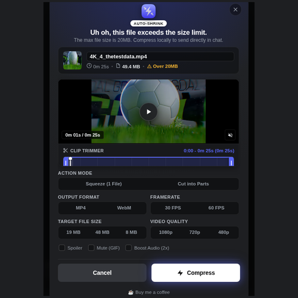
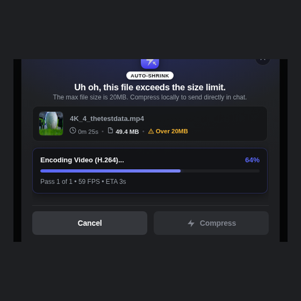

# ⚡ ShrinkCord

> **Automatically catch oversized videos and audio on Discord Web and shrink them under 20MB right in your browser.**  
> *100% Client-Side • Universal MP4 & WebM • Batch Processing • Open Source (GPLv3) • Zero Telemetry*

 

  
  &nbsp;&nbsp;
  

  <em>Left: Embedded 16:9 preview player with dual-handle timeline scrubber &amp; 2-column options • Right: Real-time client-side transcoding with progress bar and ETA</em>

---

## 😤 The Problem
You record a gaming clip or audio track on your computer. You drag it into Discord, only to be slapped with the paywall:
> ❌ **"Uh oh, this file exceeds the size limit. The max file size is 20MB."**

## ⚡ The Solution
**ShrinkCord** silently intercepts media drop and paste events on `discord.com`:
1. **Catches oversized media instantly** before Discord triggers the Nitro paywall.
2. A 1:1 Discord Nitro-style modal allows shrinking to **19MB** with custom presets.
3. Compresses video and audio **locally in your browser** at hardware speeds.
4. **Automatically attaches** the compressed file back into your Discord message box ready to send!

---

## ✨ Features (100% Free & Open Source)
- **Embedded 16:9 Video Preview Player:** In-modal frame preview with play/pause HUD, audio mute toggle, and real-time frame seeking.
- **Dual-Handle Timeline Scrubber:** Draggable start and end trimming handles with live timestamp readouts and clamped glow needle.
- **Dynamic Quick Clip Presets:** Instant trimming presets (`Full Video`, `Custom Trim`, `30s Clip`, `60s Clip`) adaptively filtered based on media duration.
- **Audio Waveform Preview & Trimming:** Animated multi-bar waveform visualizer and timestamp trimming for oversized audio tracks.
- **Auto-Split into Parts (100% Full Quality):** Option to slice oversized media into numbered parts under 19MB each preserving 100% original resolution and audio fidelity.
- **Universal MP4 Export:** Native H.264 MP4 export for seamless inline playback across iPhone/iOS, Android, Mac, and Windows.
- **60 FPS Smooth Mode:** Export high-framerate 60 FPS gaming clips or efficient 30 FPS clips under the 19MB limit.
- **Background Tab Anti-Freezing:** Dedicated Web Worker heartbeat prevents browser background tab throttling from pausing your encoding.
- **Compact 2-Column Responsive Layout:** Streamlined options grid with pinned action buttons so controls are never cut off.
- **Native Spoiler Tagging:** One-click "Mark as Spoiler" toggle automatically instructs Discord to wrap the clip in a spoiler blur layer (`SPOILER_` prefix).
- **Inline Clip Renaming:** Easily edit and rename your file right in the compression dialog before it gets attached.
- **Massive File Support:** Effortlessly handles 50MB to 500MB+ videos with adaptive bitrate scaling.
- **Batch / Queue Processing:** Drop multiple files at once — ShrinkCord queues and compresses them sequentially into your draft.
- **Target Size Presets:** Instant presets for 19 MB (Discord Free safe limit), 48 MB (Nitro Basic), or 8 MB (Compact).
- **Audio Transcoding:** Downsamples voice and studio tracks to fit under Discord limits with clean 32kHz/22kHz WAV.
- **Vencord Desktop Client Plugin:** Full native Discord desktop client support via the included Vencord userplugin.

---

## 🔒 Privacy & Security First
* **Zero Cloud Servers:** Your videos **never leave your machine**. There is no backend server.
* **Zero Tracking / Telemetry:** No analytics, no Google Analytics, no tracking pixels.
* **Safe for Discord:** Does not use Discord user tokens, does not interact with Discord bots, and does not violate Discord Terms of Service. It simply feeds a valid, smaller file into the standard upload field.

---

## 🛠️ Installation

### 🚀 Option 1: Official Microsoft Edge Add-ons Store (Recommended — 1-Click)
Install ShrinkCord directly from the official verified store with automatic updates:

  

> **Tip:** You can also install Edge extensions directly into **Google Chrome** or **Brave** by clicking *"Allow extensions from other stores"* when visiting the link above.

 

### 📦 Option 2: Chromium Manual ZIP Install (Developer Mode)
If you prefer loading directly from GitHub releases on Chrome, Brave, or Edge:

1. **Download the Extension:**
   * Download the latest **[`shrinkcord-v1.4.0.zip`](https://github.com/Isaac4096/shrink-cord/releases/latest)** from the [Releases page](https://github.com/Isaac4096/shrink-cord/releases).
2. **Extract the ZIP:**
   * Right-click the downloaded `.zip` file and select **Extract All...** to an accessible folder (e.g., `Documents/ShrinkCord`).
3. **Load into Browser:**
   * In your browser, open `chrome://extensions/` (or `brave://extensions/`, `edge://extensions/`).
   * Turn **ON** the **Developer mode** toggle in the top-right corner.
   * Click the **"Load unpacked"** button in the top-left corner.
   * Select the extracted folder containing `manifest.json`.

 

### 🦊 Option 3: Mozilla Firefox (Developer Mode)
1. In Firefox, navigate to `about:debugging#/runtime/this-firefox`.
2. Click **"Load Temporary Add-on..."**.
3. Select the `manifest.json` file inside the extracted ShrinkCord folder.
4. ShrinkCord is now active on Discord Web in Firefox!

 

### ⚡ Option 4: Vencord Plugin (Discord Desktop Client)
Want to use ShrinkCord inside the native Discord Desktop app instead of a browser?
1. Check the [`vencord-plugin/`](vencord-plugin/) folder.
2. Follow the instructions in [`vencord-plugin/README.md`](vencord-plugin/README.md) to add ShrinkCord to your Vencord installation!

---

## ⚙️ Configuration
Click the ShrinkCord icon in your browser toolbar to customize:
* **Default Video Format:** `MP4 (Universal)` (best for iPhone & Discord embeds) or `WebM`.
* **Default Target Size:** `19.0 MB` (Discord Free safe limit), `48.0 MB` (Nitro Basic), or `8.0 MB` (Compact).
* **Default Video Quality:** `1080p FHD` (crisp quality), `720p HD` (balanced), or `480p SD` (compact).
* **Default Framerate:** `30 FPS (Standard)` or `60 FPS (Smooth Gaming Clips)`.

---

## ☕ Support the Project
If ShrinkCord saved you from buying Discord Nitro or made sharing clips easier, consider supporting continued development!

  

---

## 📄 License
This project is licensed under the **GNU General Public License v3.0 (GPLv3)** — see the [LICENSE](LICENSE) file for details.
